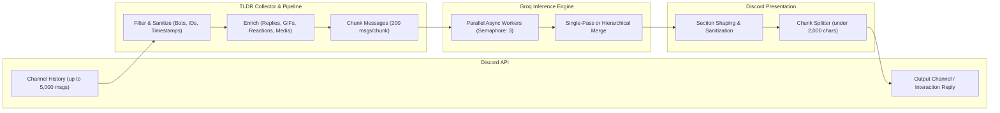

# 📜 Discord TLDR Bot

[](https://www.python.org/downloads/)
[](https://github.com/Rapptz/discord.py)
[](https://groq.com/)
[](LICENSE)

An intelligent, context-aware Discord bot that summarizes channel conversations and generates playful user roasts using high-speed LLM inference powered by **Groq**.

Unlike simple chat scrapers, **Discord TLDR Bot** enriches Discord messages with full conversational context—including reply references, top emoji reactions, image attachments, stickers, and GIF picker descriptions—before generating chronological, formatted summaries with natural humor.

---

## ✨ Features

- **⚡ Fast LLM Summaries**: Powered by Groq models (defaults to `openai/gpt-oss-120b`, configurable to `llama-3.3-70b-versatile` or any Groq chat model).
- **🧵 Deep Context Extraction**:
  - **Reply Tracking**: Resolves in-memory message references to display who users are replying to, including snippet quotes.
  - **Reaction Awareness**: Collects and ranks emoji reactions (e.g., `[Reactions: 💀x8, 👍x5]`) to capture community sentiment.
  - **Media & Sticker Enrichment**: Converts Tenor/Giphy picker slugs into readable descriptions (`[GIF: dance party]`) and notes image/sticker attachments.
- **🛡️ Mention-Safe & Secure**:
  - Enforces `AllowedMentions.none()` so summaries never trigger unauthorized `@everyone`, `@here`, or mass user/role pings.
  - Validates caller and bot channel permissions: users cannot summarize channels they cannot read, nor post summaries to channels they lack send permissions for.
- **📐 Discord-Safe Formatting**:
  - Auto-shapes summaries into bold section headings and structured paragraphs.
  - Splits long summaries across Discord's 2,000-character boundary at clean paragraph breaks without cutting mid-sentence.
- **⏱️ Per-User Cooldown**: Built-in 30-second rate limiting per user per server to protect against API abuse.
- **🔀 Flexible Routing**: Summarize any channel or thread you have access to, and optionally redirect output to a designated summary or log channel.

---

## 🤖 Slash Commands

All interactions use native Discord slash commands with ephemeral deferral for instant responsiveness.

| Command | Description | Default Arguments |
| :--- | :--- | :--- |
| **`/tldr`** | Compact, structured recap of recent chat activity | `hours=6`, `bots=False`, current channel |
| **`/tldr_full`** | Multi-part, chunked summary for long, busy discussions | `hours=6`, `bots=False`, current channel |
| **`/tldr_day`** | Full 24-hour summary for a specific calendar date (UTC) | `date` (required `YYYY-MM-DD`), `bots=False` |
| **`/tldr_user`** | Playful, message-grounded roast of a specific server member | `hours=24`, current channel |
| **`/tldr_help`** | Displays command syntax, options, and usage examples | None |

### Command Parameters

#### `/tldr` & `/tldr_full`
- `hours` *(optional, integer: 1–24, default: `6`)*: Lookback window in hours.
- `source_channel` *(optional, channel)*: Text channel, thread, voice chat, or stage channel to read messages from (default: current channel).
- `output_channel` *(optional, channel)*: Channel where the summary should be posted (default: current channel).
- `bots` *(optional, boolean, default: `False`)*: Whether to include bot messages in the summary.

**Examples:**
```text
/tldr
/tldr hours:12
/tldr hours:6 source_channel:#general output_channel:#daily-recap
/tldr_full hours:24 bots:True
```

#### `/tldr_day`
- `date` *(required, string)*: Target date formatted as `YYYY-MM-DD` (evaluated in UTC).
- `source_channel` *(optional, channel)*: Target channel to read history from.
- `output_channel` *(optional, channel)*: Target channel to send the summary to.
- `bots` *(optional, boolean, default: `False`)*: Include bot messages.

**Example:**
```text
/tldr_day date:2026-10-14 source_channel:#dev-chat
```

#### `/tldr_user`
- `user` *(required, member/user)*: The server member to roast.
- `hours` *(optional, integer: 1–24, default: `24`)*: Lookback window for user messages.
- `source_channel` *(optional, channel)*: Channel to read the user's messages from (default: current channel).

**Example:**
```text
/tldr_user user:@Alex hours:12
```

---

## 🏗️ Architecture & Pipeline



1. **Collector (`utils/messages.py`)**: Fetches messages within the requested time frame, resolving guild nicknames and reply quote snippets without extra network roundtrips.
2. **Context Enrichment**: Translates Tenor/Giphy slugs, appends image/attachment labels, and aggregates the top 5 most frequent emoji reactions per message.
3. **Async LLM Workers (`services/summarizer.py`)**: Batches messages into chunks of 200, querying Groq through a bounded concurrency semaphore (`max_concurrent_llm_calls=3`) with exponential retry backoff.
4. **Format & Safety (`utils/formatting.py`)**: Strips meta-announcements, enforces bold headings with emojis, and chunks output along natural double/single newlines.

---

## 🚀 Getting Started

### Prerequisites

- **Python 3.11+**
- A **Discord Bot Token** from the [Discord Developer Portal](https://discord.com/developers/applications)
- A **Groq API Key** from the [Groq Console](https://console.groq.com/)

> [!IMPORTANT]
> In the **Discord Developer Portal**, navigate to your application's **Bot** tab and ensure **Message Content Intent** is enabled under **Privileged Gateway Intents**.

### Required Bot Permissions

When creating your bot invite URL, grant the following permissions:
- `View Channels` / `Read Messages`
- `Read Message History`
- `Send Messages`
- `Use Application Commands`

🔗 **Quick Invite URL Generator**:
```text
https://discord.com/oauth2/authorize?client_id=YOUR_CLIENT_ID&permissions=68608&integration_type=0&scope=bot+applications.commands
```

---

### Installation & Setup

1. **Clone the repository**:
   ```bash
   git clone https://github.com/your-username/tldrBOT.git
   cd tldrBOT
   ```

2. **Create and activate a virtual environment**:
   ```bash
   # macOS / Linux
   python3 -m venv .venv
   source .venv/bin/activate

   # Windows (PowerShell)
   python -m venv .venv
   .venv\Scripts\Activate.ps1
   ```

3. **Install dependencies**:
   ```bash
   pip install -r requirements.txt
   ```

4. **Configure environment variables**:
   Copy the example environment file:
   ```bash
   cp .env.example .env
   ```
   Edit `.env` with your credentials:
   ```dotenv
   DISCORD_TOKEN=your_discord_bot_token_here
   GROQ_API_KEY=gsk_your_groq_api_key_here

   # Optional overrides
   GROQ_MODEL=openai/gpt-oss-120b
   DEV_GUILD_ID=123456789012345678
   ```

5. **Start the bot**:
   ```bash
   python main.py
   ```

---

## ⚙️ Configuration Reference

All settings are strongly typed and validated at startup in [`config.py`](config.py):

| Variable | Type | Default | Description |
| :--- | :--- | :--- | :--- |
| `DISCORD_TOKEN` | String | *(Required)* | Discord bot authentication token |
| `GROQ_API_KEY` | String | *(Required)* | Groq Cloud API authentication key |
| `GROQ_MODEL` | String | `openai/gpt-oss-120b` | Groq chat completion model |
| `DEV_GUILD_ID` | Integer | `None` | Optional guild ID for instant development command syncing |
| `cooldown_seconds` | Integer | `30` | Cooldown duration per user per server |
| `max_hours` | Integer | `24` | Maximum allowable lookback window |
| `chunk_size` | Integer | `200` | Messages processed per LLM chunk |
| `max_concurrent_llm_calls` | Integer | `3` | Maximum concurrent calls to the Groq API |
| `max_messages_fetched` | Integer | `5000` | Safety ceiling for fetched messages per command |

---

## 🧪 Testing

The test suite validates media enrichment, reply chain resolution, emoji reaction formatting, and configuration validation.

Run the tests using Python's built-in `unittest` runner:

```bash
python -m unittest discover -s tests
```

---

## 📂 Project Structure

```text
tldrBOT/
├── cogs/
│   └── tldr.py             # Discord slash commands, permissions check & interaction handling
├── services/
│   └── summarizer.py       # Groq API client, prompt templates, parallel chunking & merge logic
├── utils/
│   ├── formatting.py       # Discord markdown formatting, section shape enforcement & message chunker
│   └── messages.py         # Message collection, reaction formatting, GIF/media & reply resolution
├── tests/
│   ├── test_media.py       # Unit tests for GIF, image, and sticker enrichment
│   ├── test_phase0.py      # Unit tests for Config validation and dev guild parsing
│   ├── test_reactions.py  # Unit tests for reaction formatting and ranking
│   └── test_replies.py    # Unit tests for reply tree and quotation snippet extraction
├── bot.py                  # Bot initialization, intent configuration, and ready event
├── config.py               # Immutable, validated environment configuration
├── main.py                 # Application entrypoint and command tree synchronization
├── requirements.txt        # Runtime dependencies
└── LICENSE                 # MIT License
```

---

## 🔒 Security Best Practices

- **Never commit `.env`**: Ensure `.env` remains in `.gitignore`.
- **Privileged Scope**: Do not give the bot Administrator permissions; it only requires read history, view channel, and send messages.
- **Prompt Injection Defense**: Untrusted message inputs are segregated from system instructions and personality rules.
- **Rate-Limit Resilience**: Bounded semaphores prevent flooding LLM APIs, and Discord cooldowns prevent gateway spam.

---

## 📄 License

This project is open-source and distributed under the [MIT License](LICENSE).
